# CoolGrid

## AI & Physics-Informed Urban Heat Intelligence Platform

[](LICENSE)
[](https://nextjs.org/)
[](https://fastapi.tiangolo.com/)
[](https://python.org)
[](https://www.typescriptlang.org/)
[](https://github.com/daanialmirza5/Coolgrid-Webverse/actions)

**Turn Urban Heat Into Action.**

```
DETECT → EXPLAIN → PREDICT → SIMULATE → OPTIMIZE
```

Built for **Webverse 2026** by a team from Wadia College of Engineering, Pune.

> **DEMO DATA NOTICE**: This application runs entirely on a synthetic, clearly-labeled demonstration dataset for a Pune-*shaped* demo city. No real Landsat, Sentinel-2, ERA5, OpenStreetMap, or census data is used anywhere. The UI labels this everywhere it matters (dashboard badge, data sources page, PDF reports). See [Data Sources](#data-sources) and [docs/DATA.md](docs/DATA.md) for exactly how it's generated and why. The codebase is architected so real providers can be plugged in later with zero changes to the application logic that consumes them — see [providers/factory.py](ml/coolgrid_ml/providers/factory.py).

## Live Demo

Not yet deployed to a public URL — see [Deployment](#deployment) for how to run it yourself in a few minutes.

## GitHub Repository

[github.com/daanialmirza5/Coolgrid-Webverse](https://github.com/daanialmirza5/Coolgrid-Webverse)

## Table of Contents

- [Overview](#overview)
- [Problem](#problem)
- [Solution](#solution)
- [Key Features](#key-features)
- [How CoolGrid Works](#how-coolgrid-works)
- [Architecture](#architecture)
- [Technology Stack](#technology-stack)
- [Screenshots](#screenshots)
- [Machine Learning](#machine-learning)
- [Physics-Informed Modeling](#physics-informed-modeling)
- [What-If Simulation](#what-if-simulation)
- [Optimization](#optimization)
- [Data Sources](#data-sources)
- [Project Structure](#project-structure)
- [Local Installation](#local-installation)
- [Environment Variables](#environment-variables)
- [Database](#database)
- [Demo Mode](#demo-mode)
- [API](#api)
- [Testing](#testing)
- [Deployment](#deployment)
- [Limitations](#limitations)
- [Future Improvements](#future-improvements)
- [References](#references)
- [AI-Assisted Development](#ai-assisted-development)
- [Author](#author)

## Overview

CoolGrid is a full-stack urban heat intelligence platform. It takes a city's ward-level urban form and environmental data, detects where and how badly urban heat island effects are hurting a city, explains *why* in plain language, forecasts how it will evolve, simulates the physical cooling effect of concrete interventions, and searches for the best-value combination of interventions under real budget/land/water constraints — producing a ranked, testable, exportable city decision instead of a static heat map.

## Problem

Indian cities like Pune face intensifying urban heat island effects: dense, low-vegetation, high-albedo-deficit wards run several degrees hotter than their surroundings, concentrating heat risk on the most vulnerable populations. City planners typically have access to a heat map at best — not an explanation of *why* a ward is hot, a forecast of what's coming, a physically grounded estimate of what a given intervention would actually achieve, or a way to compare interventions against limited budget, land, and water.

## Solution

CoolGrid closes that gap with a single pipeline: **DETECT** hotspots with a trained ML model, **EXPLAIN** each one with SHAP-based driver attribution, **PREDICT** how it evolves over 1/7/30 days with honest confidence ranges, **SIMULATE** the physics-based cooling effect of 6 intervention types, and **OPTIMIZE** across all of them under real-world constraints to produce a ranked, defensible recommendation — plus a downloadable PDF report a planner can actually use.

## Key Features

- **Heat hotspot detection** — XGBoost regressor predicts land surface temperature (LST) per ward and ranks wards into a LOW/MODERATE/HIGH/CRITICAL hotspot list with a 0–100 heat score.
- **Heat-risk mapping** — interactive MapLibre GL choropleth over 5 layers (LST, risk level, vegetation, built-up density, population), fully theme-aware (light/dark).
- **Heat-driver explanation** — SHAP `TreeExplainer` attribution, direction-aware ("Low vegetation" vs. "Ample vegetation") and grouped so transient weather doesn't drown out actionable urban-form drivers.
- **Future heat prediction** — 1/7/30-day LST forecasts blending the detector with the physics layer, with anomaly-persistence decay and explicit confidence ranges, never presented as guaranteed.
- **Physics-informed modeling** — a documented simplified surface energy balance (Oke 1982-style) grounds the demo dataset and every simulation; a lightweight PyTorch PINN trained with a combined data+physics loss.
- **Cooling intervention simulation** — what-if modeling for 6 intervention types with Monte Carlo confidence intervals on the cooling estimate.
- **Intervention comparison** — ward comparison view and side-by-side recommendation cards.
- **Constraint-aware optimization** — grid search over intervention coverage levels ranked by a weighted multi-objective score, respecting budget/land/water constraints.
- **Population benefit, cost, land & water accounting** — every simulated and optimized result reports population benefited, cost, land required, and water required, not just a temperature delta.
- **Confidence/uncertainty everywhere** — quantile-regression detection intervals, Monte Carlo simulation intervals, and forecast confidence that widens with horizon; nothing is presented as a bare point estimate.
- **Actionable recommendations** — natural-language, metrics-backed recommendations generated directly from optimization results, not static text.
- **PDF reports** — downloadable reports covering heat situation, drivers, predictions, simulation/optimization, recommendations, data sources, and methodology.
- **Full authentication** — registration, login, JWT access/refresh tokens, forgot/reset password, role-based access (admin/analyst/viewer), protected routes, audit logging.
- **18 functional pages**, responsive from mobile to desktop, with loading/empty/error states throughout.

## How CoolGrid Works

The primary user journey, exactly as a city planner (or a judge) would run it:

```
LOGIN → DASHBOARD → SELECT CITY → HEAT MAP → SELECT HOTSPOT → HOTSPOT DETAILS
  → WHY IS IT HOT? → PREDICTION → WHAT-IF SIMULATION → CHANGE INTERVENTIONS
  → RUN SIMULATION → VIEW COOLING → OPTIMIZATION → SET CONSTRAINTS
  → RUN OPTIMIZATION → VIEW RECOMMENDATION → GENERATE REPORT → LOGOUT
```

This exact journey is codified as an automated end-to-end test: [`frontend/e2e/full-journey.spec.ts`](frontend/e2e/full-journey.spec.ts).

## Architecture

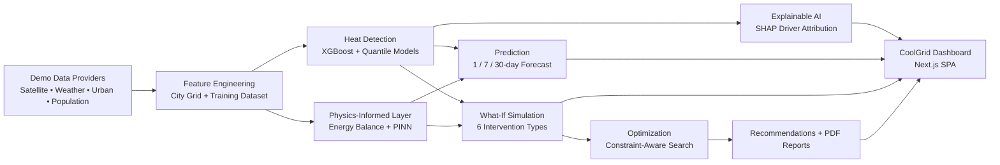

Three tiers: a Next.js SPA-style frontend, a FastAPI backend, and an in-process ML/physics package (`coolgrid_ml`) that the backend imports directly — no separate ML microservice or HTTP hop. See [docs/ARCHITECTURE.md](docs/ARCHITECTURE.md) for the full data flow, request lifecycle, and design rationale behind decisions like the demo reference-date clock and detection caching.

## Technology Stack

**Frontend**: Next.js 16.3 (App Router, Turbopack), React 19, TypeScript, Tailwind CSS v4, hand-built shadcn/ui-style components (class-variance-authority), Recharts 3, MapLibre GL JS 6.

**Backend**: Python 3.12, FastAPI, Pydantic v2, SQLAlchemy 2.0, GeoAlchemy2, Alembic, PyJWT, passlib (bcrypt), ReportLab.

**Database**: PostgreSQL 16 + PostGIS 3.4 (Docker), GIST spatial indexes on ward/location geometry.

**ML / Geospatial**: XGBoost, scikit-learn, SHAP, PyTorch (PINN), NumPy/Pandas, Shapely.

**Testing**: pytest (backend + ML), Playwright (E2E).

## Screenshots

All screenshots below are real browser captures of the running application (see [docs/screenshots/](docs/screenshots/)), not mockups.

### Landing Page

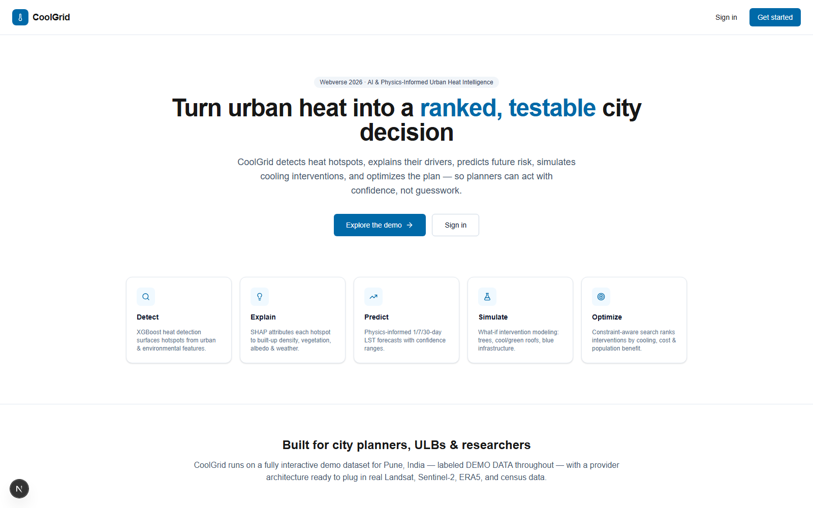

### Dashboard

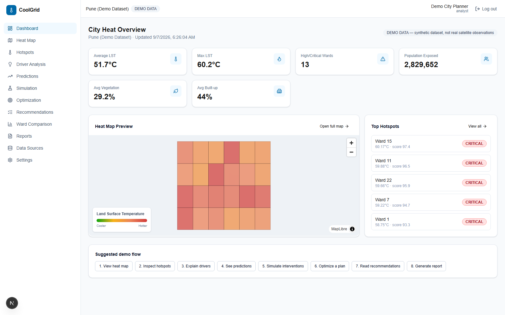

### Heat Map

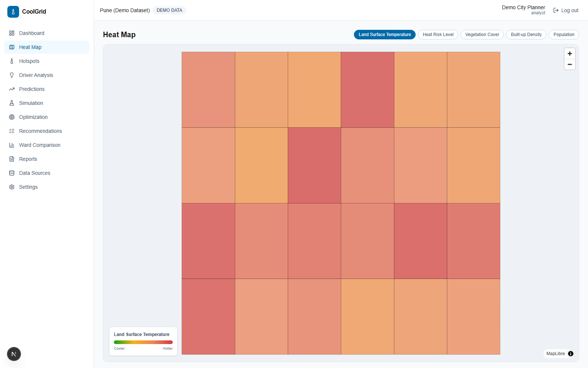

### Hotspot Details

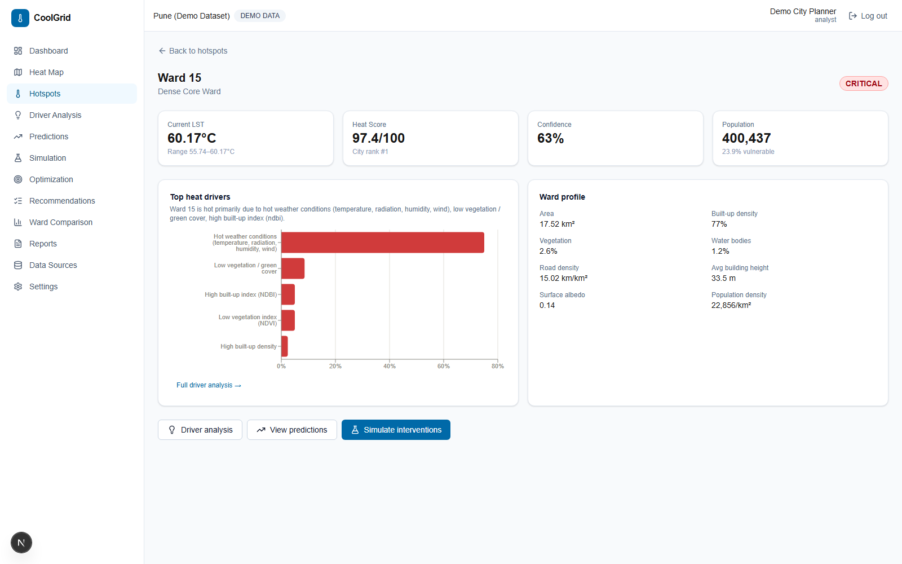

### Explainable AI — Driver Analysis

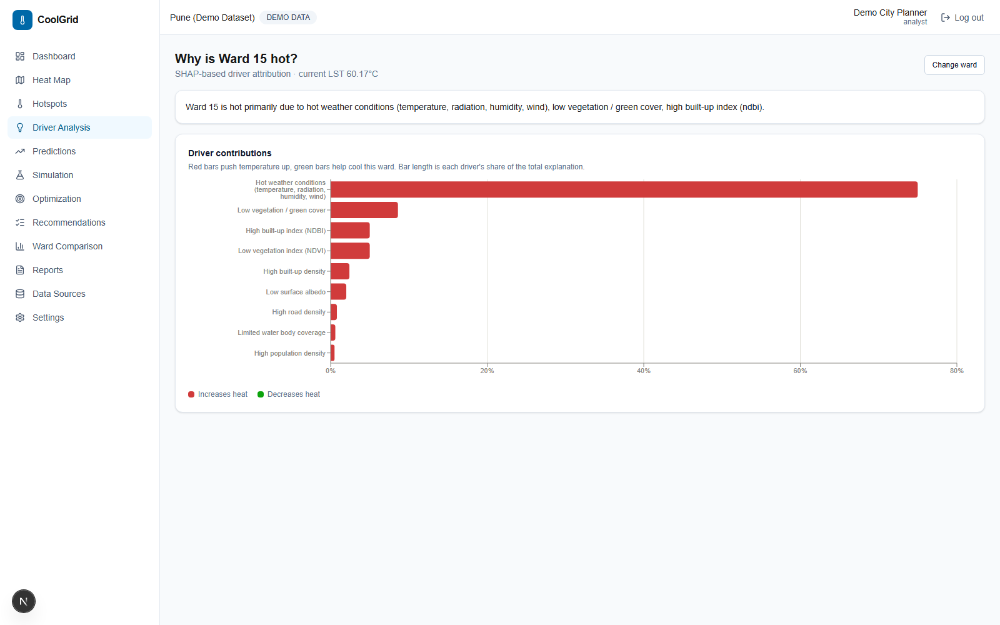

### Prediction

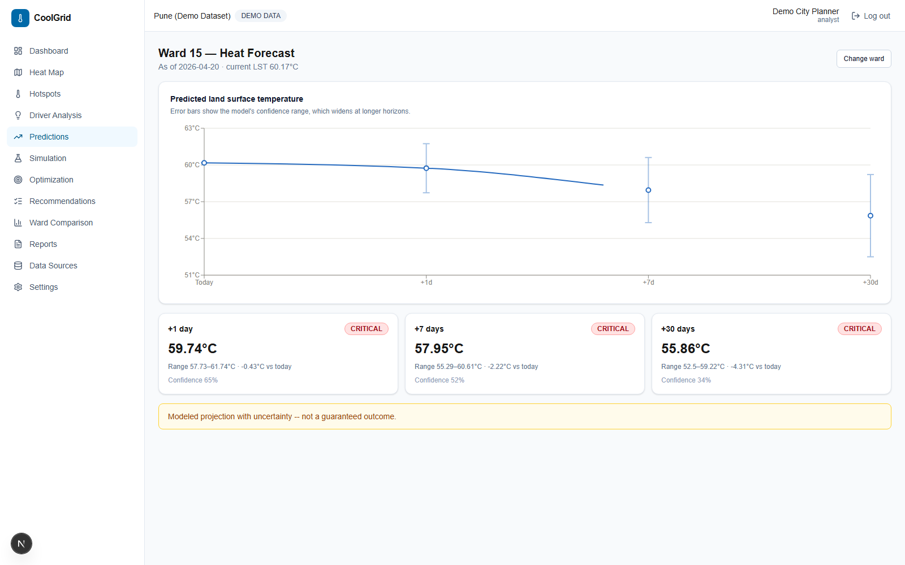

### What-If Simulation

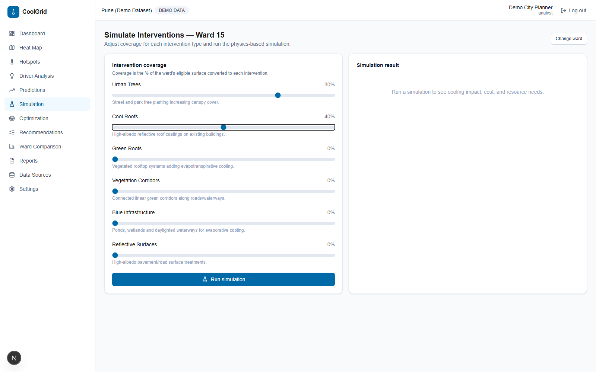

### Simulation Results

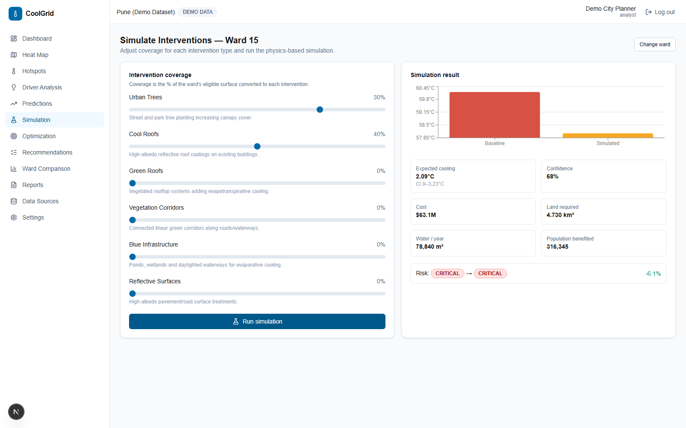

### Optimization

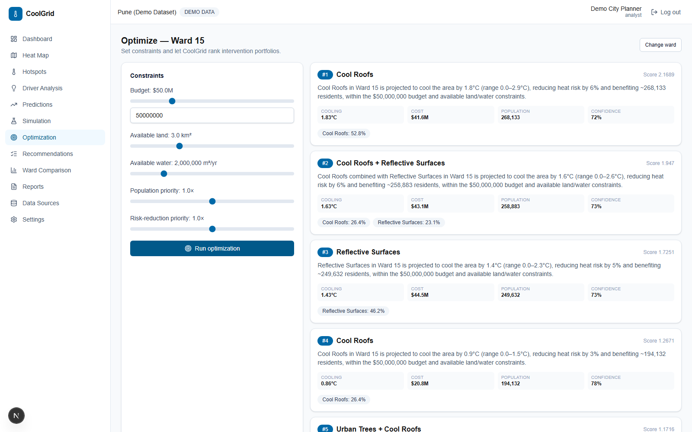

### Recommendations

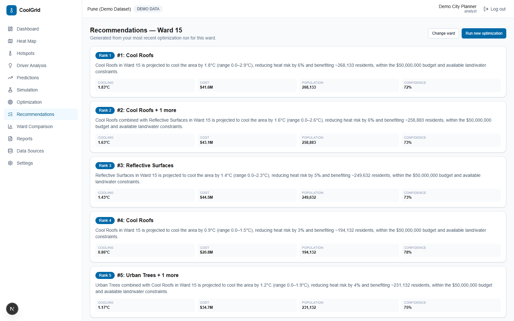

### Report

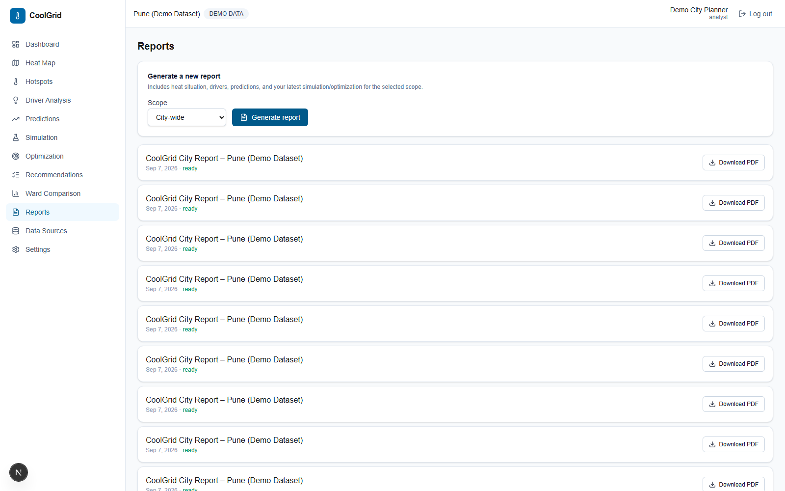

## Machine Learning

An XGBoost regressor predicts LST from 12 urban/environmental features (NDVI, NDBI, albedo, built-up density, vegetation %, water %, road density, population density, humidity, wind, solar radiation, air temperature). Two additional quantile-regression models (`reg:quantileerror`, α = 0.1/0.9) give data-driven confidence intervals — wards with atypical feature combinations get wider intervals, not a fixed ± band. SHAP `TreeExplainer` provides per-ward, direction-aware driver attribution.

**Current metrics** (held-out 20% split, `data/demo/models/heat_detection/meta.json`): **MAE 0.61°C, RMSE 0.82°C, R² 0.99**. These are real numbers from this repo's own training run on its own synthetic dataset — not a claim about performance on real satellite data, which has not been attempted. See [docs/ML.md](docs/ML.md) for the full feature list, training procedure, and the design decisions behind the grouped/direction-aware driver labeling.

## Physics-Informed Modeling

A simplified surface energy balance (Rn = H + LE + G, after Oke 1982) computes net radiation, latent heat (evapotranspirative cooling from vegetation/water), and ground heat storage from albedo/vegetation/water/built-up inputs, then derives a surface-air temperature offset via a bulk aerodynamic formula — with built-up density independently reducing near-surface wind mixing (urban canyon effect), and a documented clamp keeping the offset within a physically plausible band. This model **generates** the demo dataset's ground-truth LST (a real, recoverable relationship a model can learn and SHAP can explain — not hardcoded), **blends into** every prediction, and **drives** every simulation's cooling estimate.

A lightweight PyTorch MLP (`ml/coolgrid_ml/physics/pinn.py`) is additionally trained with a combined loss (`(1-w)·MSE(pred, observed) + w·MSE(pred, physics_estimate)`, w = 0.35) — an honest description: this is a **physics-informed constraint** via the loss function (a soft physical prior on tabular ward-level features), not a PDE-residual PINN over spatiotemporal coordinates. See [docs/ML.md](docs/ML.md#5-physics-physics) for the full assumption list, including two real bugs this project hit and fixed (a sign error that made built-up density *reduce* LST, and a low-wind singularity that produced a 225°C output before a physical clamp was added).

## What-If Simulation

Six intervention types, each with a documented effect on albedo/vegetation/water/built-up-density plus illustrative unit cost/land/water metadata:

| Intervention | Mechanism |
|---|---|
| Urban Trees | Canopy cover raises vegetation index, adds shade |
| Cool Roofs | High-albedo reflective roof coatings |
| Green Roofs | Vegetated rooftops, adds evapotranspirative cooling |
| Vegetation Corridors | Connected linear green corridors along roads/waterways |
| Blue Infrastructure | Ponds/wetlands/daylighted waterways for evaporative cooling |
| Reflective Surfaces | High-albedo pavement/road treatments |

### Interactive Scenario Presets (Zero-Config Testing)

For recruiters and municipal decision-makers evaluating climate strategies, CoolGrid provides 5 curated, physics-calibrated presets that immediately configure the multi-intervention parameters:

- **Reflective Cool Roofs (High Albedo / Fast Deploy)**: 60% cool roofs, 20% reflective pavement. Maximizes solar reflection with zero land or water consumption.
- **Urban Canopy & Corridors (Biophilic Evapotranspiration)**: 30% street trees, 15% linear green corridors, 5% blue infrastructure. Focuses on biophilic shade and ambient humidity.
- **Commercial Core Retrofit (Balanced Multi-Layer)**: 40% cool roofs, 25% intensive green roofs, 15% trees, 20% high-albedo pavements tailored for dense high-rise wards.
- **Emergency Heatwave Shield (Hotspot Suppression)**: 65% cool roofs, 45% reflective pavements, 25% trees, 10% water bodies for extreme heat mitigation.
- **Arid Passive Albedo (100% Water-Neutral)**: 75% cool roofs, 50% reflective surfaces specifically engineered for drought-sensitive microclimates.

Adjusting any intervention's coverage slider genuinely changes the result: the simulation engine re-solves the physics energy balance under the perturbed surface attributes and Monte Carlo-samples weather noise (60 samples) for a real confidence interval — not a lookup table. Every run reports **baseline LST, simulated LST, expected cooling with confidence range, cost, land required, water required, population benefited, and risk-level change**, re-based onto the ward's actual detected LST so it's consistent with the rest of the app.

## Optimization

Given a ward and constraints — **budget, available land, available water, population priority, risk-reduction priority** — CoolGrid runs a discretized grid search (4 coverage levels × 6 intervention types, up to 4,095 candidate portfolios), filters by feasibility, and scores survivors by a weighted multi-objective function (cooling, population benefit, risk reduction vs. cost, land, water). The top 5 ranked portfolios are returned, each with **score, cooling, cost, population benefit, land, water, confidence, and a natural-language reason generated from the actual simulation numbers** — never static text. An infeasible budget correctly returns an empty state ("no feasible strategy found"), not a crash or a fabricated result.

## Data Sources

CoolGrid ships with **demo data only** — no paid API keys required to run the full application. `ml/coolgrid_ml/providers/` defines abstract interfaces (`SatelliteDataProvider`, `WeatherDataProvider`, `UrbanDataProvider`, `PopulationDataProvider`) with `Demo*` implementations active by default:

| Domain | Demo provider (active) | Real replacement (architected for, not implemented) |
|---|---|---|
| Satellite (LST, NDVI, NDBI, albedo) | `DemoSatelliteProvider` | Google Earth Engine: Landsat 8/9, Sentinel-2, ECOSTRESS where available |
| Weather | `DemoWeatherProvider` | ERA5 reanalysis (Copernicus CDS) |
| Urban form | `DemoUrbanProvider` | OpenStreetMap (building footprints, roads, land use) |
| Population | `DemoPopulationProvider` | Census / gridded population (e.g. WorldPop) |

Each real provider would implement the same abstract base class and register in `providers/factory.py`, gated by credential presence — **zero other application code would need to change**, since detection/prediction/simulation/optimization all consume the provider interfaces, never a concrete class. See [docs/DATA.md](docs/DATA.md) for the full generation pipeline (city grid archetypes, seasonal climatology, the physics-grounded LST label).

## Project Structure

```
coolgrid/
├── frontend/    Next.js 16 (App Router) + TypeScript + Tailwind v4 + MapLibre GL + Recharts
├── backend/     FastAPI + SQLAlchemy + PostgreSQL/PostGIS + Alembic + JWT auth
├── ml/          coolgrid_ml: providers, data, detection, explain, physics, prediction, simulation, optimization
├── data/        generated demo seed data + trained model artifacts (gitignored, regenerate via ml/train.py)
├── tests/       backend API tests (pytest + FastAPI TestClient)
└── docs/        architecture, API, ML, data, demo docs + screenshots
```

Key files:

- `backend/app/main.py` — FastAPI app, router wiring, CORS, exception handlers
- `backend/app/models/` — SQLAlchemy models (17 tables)
- `backend/app/services/` — business logic bridging DB models and `coolgrid_ml`
- `backend/app/seed.py` — demo data seeding script
- `ml/coolgrid_ml/` — the ML/physics package (see [docs/ML.md](docs/ML.md))
- `ml/train.py` — trains and exports all ML artifacts + demo city/dataset
- `frontend/app/` — Next.js App Router pages (route group `(app)` = authenticated shell)
- `frontend/lib/api-client.ts` — typed fetch client with JWT refresh handling

## Local Installation

Prerequisites: Node 20+, pnpm, Python 3.11+ (3.12 recommended), Docker Desktop, Git.

```powershell
# 1. Clone and enter the repo
git clone https://github.com/daanialmirza5/coolgrid.git
cd coolgrid

# 2. Start PostgreSQL/PostGIS
docker compose up -d

# 3. Python environment (backend + ml share one venv)
py -3.12 -m venv .venv
.venv\Scripts\pip install -e ./ml
.venv\Scripts\pip install -r backend/requirements.txt

# 4. Train and export ML artifacts + demo city dataset
cd ml
..\.venv\Scripts\python train.py
cd ..

# 5. Configure backend env
copy backend\.env.example backend\.env

# 6. Run database migrations
cd backend
..\.venv\Scripts\alembic upgrade head

# 7. Seed demo data (city, wards, observations, users, initial detection run)
..\.venv\Scripts\python -m app.seed
cd ..

# 8. Frontend dependencies
cd frontend
pnpm install
copy .env.example .env.local
cd ..
```

Then run the backend and frontend (see below) and open the printed local URL. Sign in with the [demo credentials](#demo-mode).

## Environment Variables

| File | Purpose |
|---|---|
| `.env.example` (root) | docker-compose Postgres credentials (has working defaults) |
| `backend/.env.example` | `DATABASE_URL`, JWT secret/algorithm/expiry, `CORS_ORIGINS`, demo user credentials |
| `frontend/.env.example` | `NEXT_PUBLIC_API_URL` (backend base URL) |

Never commit real secrets — `.env` files are gitignored; only `.env.example` files are checked in with placeholder values.

**Running the backend:**

```powershell
cd backend
..\.venv\Scripts\python -m uvicorn app.main:app --reload --port 8000
```

Health check: `GET http://localhost:8000/health`. Interactive API docs: `http://localhost:8000/docs`.

**Running the frontend:**

```powershell
cd frontend
pnpm dev        # http://localhost:3000 (or next available port)
```

`pnpm build && pnpm start` for a production build. `pnpm lint` runs ESLint (0 errors/warnings in this repo).

## Database

Schema is managed via Alembic (`backend/alembic/`). Migration `0001_enable_postgis` enables the PostGIS extension; `..._initial_schema` creates all **17 tables**, including `Ward`/`Location` with GeoAlchemy2 `Geometry` columns carrying GIST spatial indexes (auto-managed by GeoAlchemy2's DDL events).

```powershell
cd backend
..\.venv\Scripts\alembic upgrade head       # apply migrations
..\.venv\Scripts\alembic revision --autogenerate -m "..."   # after model changes
```

The autogenerate config (`alembic/env.py`) filters out the `tiger_geocoder`/`topology` tables the `postgis/postgis` Docker image also installs, so autogenerate never proposes dropping them.

## Demo Mode

CoolGrid runs entirely on synthetic data — see [Data Sources](#data-sources) and [docs/DATA.md](docs/DATA.md) for the full generation methodology. In short: `ml/train.py` generates a synthetic Pune-*shaped* 24-ward city grid, a 240-day historical observation dataset with a real, physically-grounded relationship between urban form and LST, and trains the detection model and PINN on it. `backend/app/seed.py` loads this into PostgreSQL along with demo users and the intervention catalog. A pinned **demo reference date** (`2026-04-20`, a pre-monsoon peak-heat day) keeps the detection/prediction/simulation pipeline showing consistent, hotspot-rich results regardless of the real calendar date the demo happens to be run on — documented in [docs/ARCHITECTURE.md](docs/ARCHITECTURE.md#the-demo-clock).

Demo login: **demo@coolgrid.app** / **CoolGrid#Demo2026** (analyst role), or **admin@coolgrid.app** / **CoolGrid#Admin2026** (admin role) — change these in `backend/.env` before deploying anywhere real users could reach it.

See [docs/DEMO.md](docs/DEMO.md) for a full recommended judging flow (~5–10 minutes) walking through every page in the order described in [How CoolGrid Works](#how-coolgrid-works).

## API

See [docs/API.md](docs/API.md) for the full endpoint reference, or browse the live OpenAPI docs at `/docs` once the backend is running.

## Testing

```powershell
# ML unit tests (physics, detection, explainability, prediction, simulation, optimization)
cd ml && ..\.venv\Scripts\python -m pytest tests -q

# Backend API tests (auth, geo, heat detection, simulation, optimization, reports, admin)
cd .. && .venv\Scripts\python -m pytest tests\backend -q

# Frontend build + lint (type-checks and lints all 21 routes)
cd frontend && pnpm build && pnpm lint

# Frontend E2E tests (Playwright) -- requires the backend + a `pnpm dev` server already running
cd frontend && pnpm test:e2e
```

**Current status: 21 ML tests + 34 backend tests + 31 Playwright E2E tests passing (86 total), 0 frontend build/lint errors.** The E2E suite includes the complete required user journey end-to-end ([`full-journey.spec.ts`](frontend/e2e/full-journey.spec.ts)), a dark-mode regression test for the heat map, and a responsive-layout check (no horizontal overflow at mobile/tablet viewports across 6 key pages). See [tests/e2e/README.md](tests/e2e/README.md) for the full breakdown.

Every number above comes from re-running the suites during this release pass, not from an earlier claim — including two real bugs this pass caught and fixed: a dark-mode stacking bug where the map canvas painted over the legend/detail-card overlays, and a chart-sizing issue where the hotspot page's mini driver chart wrapped its longest label into the plot area.

## Deployment

This repo is configured for local/self-hosted deployment out of the box:

- **Database**: `docker-compose.yml` runs PostgreSQL/PostGIS; point `DATABASE_URL` at a managed Postgres+PostGIS instance (e.g. Supabase, Neon with the PostGIS extension, RDS) for production.
- **Backend**: any ASGI host (Uvicorn/Gunicorn behind a reverse proxy) — Render, Railway, Fly.io, or a VM all work. Set a real `JWT_SECRET_KEY`, `CORS_ORIGINS` matching your deployed frontend origin, and real demo credentials before exposing publicly.
- **Frontend**: `pnpm build` produces a standard Next.js production build; deploy to any Node host (Vercel is the natural fit for Next.js). Set `NEXT_PUBLIC_API_URL` to the deployed backend's public URL.
- **ML artifacts**: `data/demo/models/` must exist before the backend starts (it raises a clear startup error otherwise) — run `ml/train.py` as part of your deploy pipeline, or commit the artifacts if you prefer not to retrain on every deploy.

**Why there's no live URL yet**: publishing a public URL requires an account with a hosting provider (a database host, a backend host, and a frontend host) and its API credentials, none of which exist in the environment this was built in. Everything needed to deploy in a few minutes is here — Docker Compose for the database, a standard FastAPI app, and a standard Next.js build — it just needs to be pointed at real infrastructure and credentials, which is a decision (and an account) for whoever owns this repo to make.

## Limitations

- All data is synthetic demo data for a Pune-*shaped* (not real-boundary) 24-ward grid city — never presented as real satellite/weather/census data.
- The physics layer is a simplified bulk-parameter model (documented assumptions in `ml/coolgrid_ml/physics/energy_balance.py`), not empirically validated against real measurements.
- The PINN is a physics-informed *constraint* via a combined loss on tabular features, not a spatiotemporal PDE-residual PINN.
- Intervention cost/land/water figures are illustrative planning-level placeholders, not sourced from a validated costing database.
- Predictions are climatology + anomaly-persistence projections with explicit confidence ranges — never guarantees.
- The optimizer performs a discretized grid search (4 coverage levels × 6 intervention types), not a full continuous/integer program.
- No email provider is configured; password reset returns the token directly in the API response (clearly labeled as demo behavior) instead of emailing it.
- Single-city demo deployment; multi-city support would need city-scoping added to a handful of endpoints that currently default to "the" demo city.
- Not yet deployed to a public URL (see [Deployment](#deployment)).

## Future Improvements

- Real `GoogleEarthEngineSatelliteProvider` / ERA5 / OSM / census provider implementations against the existing interfaces.
- Multi-city support with a city switcher in the UI.
- Continuous-parameter optimization (e.g. scipy constrained optimization) alongside the current grid search for finer-grained portfolios.
- Real email delivery for password reset.
- Historical trend charts using the seeded observation time series (currently only used for model training).
- A real hosted deployment (database + backend + frontend) once infrastructure credentials are available.

## References

- Oke, T.R. (1982). *The energetic basis of the urban heat island.* Quarterly Journal of the Royal Meteorological Society — the surface energy balance formulation (Rn = H + LE + G) this project's physics layer is based on.
- Lundberg, S.M. & Lee, S.-I. (2017). *A Unified Approach to Interpreting Model Predictions.* NeurIPS — SHAP, used for driver explainability.
- Chen, T. & Guestrin, C. (2016). *XGBoost: A Scalable Tree Boosting System.* KDD — the detection model.
- Raissi, M., Perdikaris, P. & Karniadakis, G.E. (2019). *Physics-informed neural networks.* Journal of Computational Physics — the general PINN concept this project's simplified constraint-loss network draws on.

## AI-Assisted Development

CoolGrid was developed with AI-assisted software engineering tools — specifically **Claude (Anthropic)**, used as a pair-programming and engineering assistant across this project's implementation, debugging, testing, documentation, and development workflow. Concretely: the frontend, backend, and ML/physics pipeline described throughout this README were built through an extended, iterative collaboration between the project owner and Claude, including the bug-hunting and fixes called out in [Testing](#testing) and in the commit history (e.g. the weather-provider RNG mismatch, the energy-balance sign error, and the dark-mode map stacking bug).

The project's direction, product decisions, requirements, architecture choices, review, and final submission are owned and maintained by the project author. This disclosure exists so that how the project was actually built stays transparent rather than implied one way or the other — it isn't a caveat about quality; every number and behavior described in this README was independently verified against a fresh run of the actual code and tests as part of preparing this release, not taken on faith from either party.

## Author

Built by **Team CoolGrid**, Wadia College of Engineering, Pune, for **Webverse 2026**.

GitHub: [@daanialmirza5](https://github.com/daanialmirza5)
